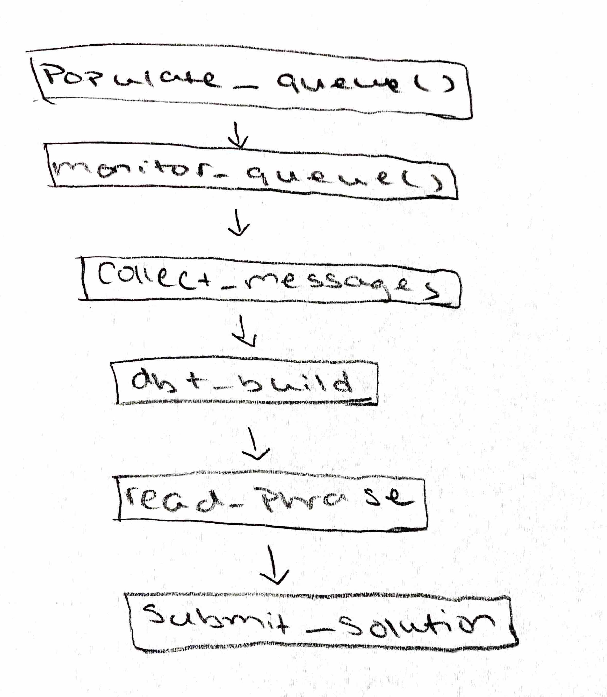
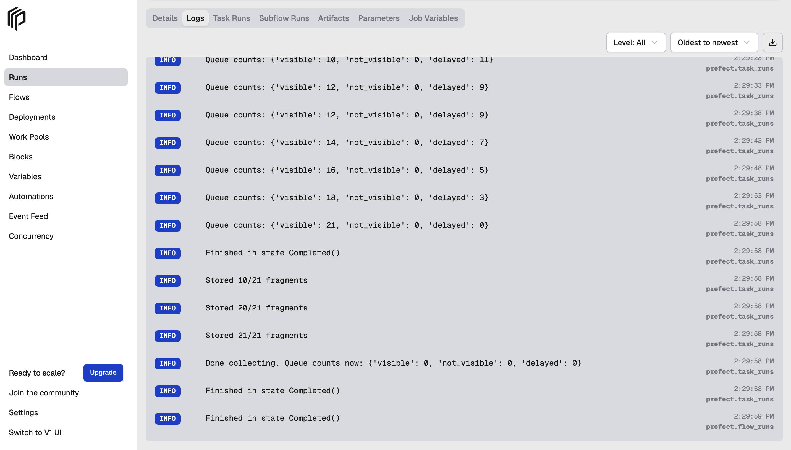
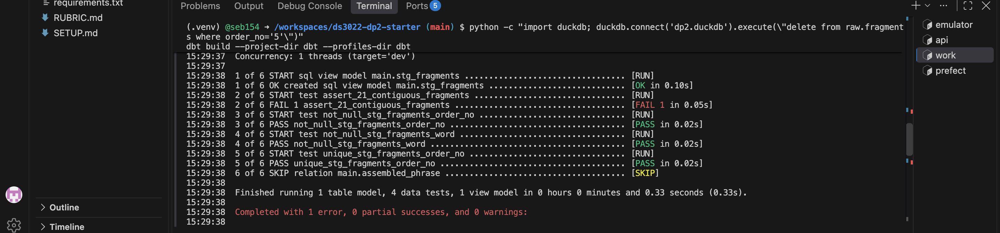
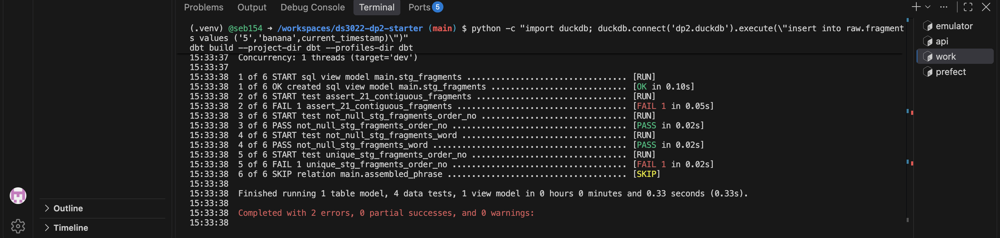
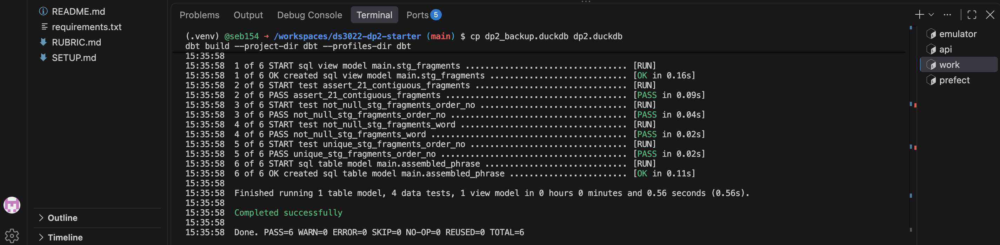
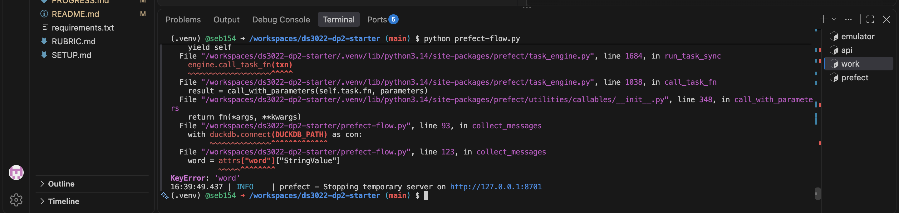
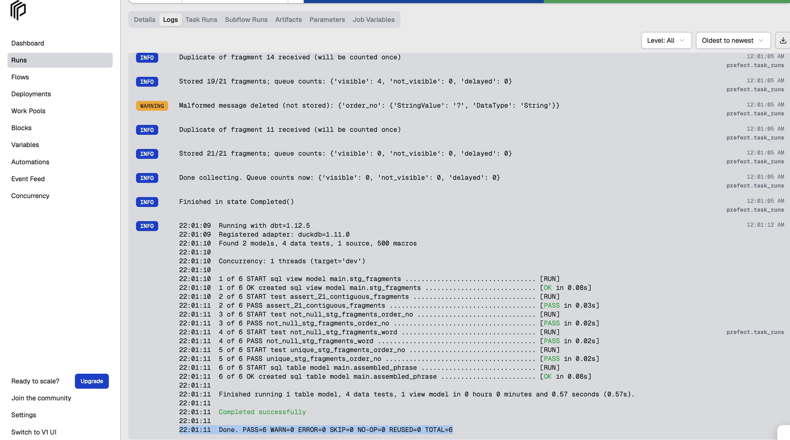
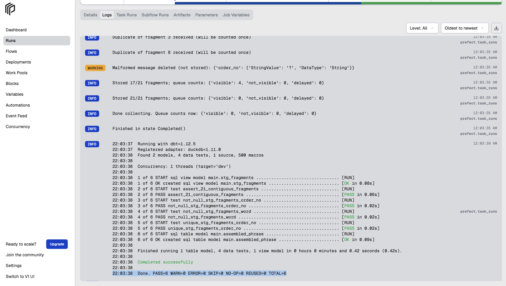
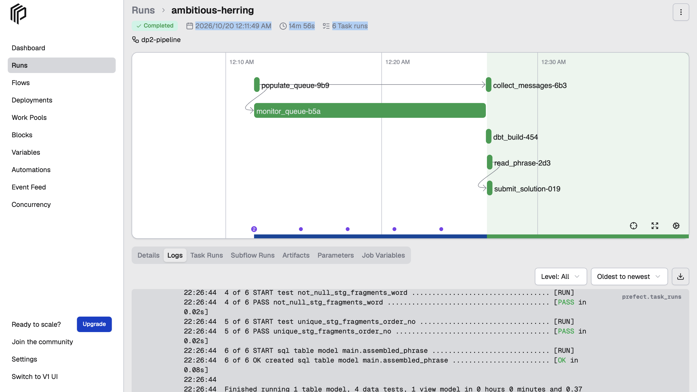
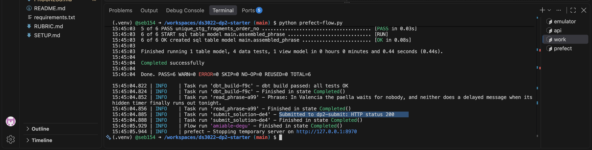

# DS 3022 Data Project 2 (Fall 2026): The SQS Puzzle

**Author:** Seble Bedassa (cjw9zn)

**Receipt code:** `PASS  cjw9zn / prefect  receipt: 79E77759D6`

A Prefect pipeline that POSTs to the scatter API, waits for 21 delayed SQS messages,
lands each fragment in DuckDB, uses dbt to clean, test and reassemble the phrase,
and submits it to the `dp2-submit` queue.

## 1. Setup and run

```bash
git clone <this repo>
cd ds3022-dp2-starter
python3 -m venv .venv
source .venv/bin/activate          1
pip install -r requirements.txt
```
Then open `.env` and set `UVA_ID` to your computing ID.

Open four terminals, activate the venv in each, and start them in this order:

| Terminal | Command | 
|---|---|
| T1 Emulator | `moto_server -p 9324` |
| T2 Scatter API | `python kit/scatter_api.py` | 
| T4 Prefect | `prefect server start` | 
| T3 Work | `python kit/smoke_test.py` (should print `Emulator OK`) |

Then in T3:

```bash
python prefect-flow.py               #runs the whole pipeline
python kit/check_submission.py      #prints PASS and the receipt code
```


## 2. Pipeline design (DAG)



| Task | What it does | 
|---|---|
| `populate_queue` | Asks the scatter API to put 21 messages in queue |
| `monitor_queue` | Checks the queue every 5 seconds. |
| `collect_messages` | Receives each message, saves it in DuckDB, deletes it from the queue. |
| `dbt_build` | Runs dbt to clean and test the data. Stops the pipeline if a test fails. |
| `read_phrase` | Reads the finished phrase. |
| `submit_solution` | Sends the phrase to `dp2-submit` queue. |


## 3. Polling strategy

**What I did and Why:**
1. Every 5 seconds I check three counts: visible, not visible and delayed. Checking the counts shows me the progress in the logs. 
2. I ask for up to 10 messages at a time. I keep going until I have all 21 words and the queue is empty.  I only start collecting when the messages are actually ready.

**What I didn't do:**
- Wait a fixed 900 seconds. It waits the longest possible time even when the messages are ready sooner.
- Ask for messages nonstop from the start. 

## 4. Receive → store → delete

For each message (in this order):
1. **Receive** it from the queue.
2. **Save** it in DuckDB (table `raw.fragments`).
3. **Delete** it from the queue.

I save before deleting to assure that if the program crashes, the word wouldn't be lost forever. If the program crashes after saving but before deleting, it only makes duplicates which dbt removes later on.

**Empty responses:** when no messages are ready, SQS sends back an answer with no `Messages`. I use `resp.get("Messages", [])`, so I get an empty list instead of a crash.

**Running again:** each run starts with an empty table, no old data.

After collecting, all three queue counts are 0:



## 5. dbt tests 

| File | What it does |
|---|---|
| `stg_fragments.sql` | Turns `order_no` into a number, removes extra spaces and duplicate rows. |
| `schema.yml` | Tests that `order_no` is never empty and repeated, and that `word` is never empty. |
| `assert_21_contiguous_fragments.sql` | Fails unless the order numbers are exactly 1 to 21, with no gaps. |
| `assembled_phrase.sql` | Joins the words in order into one phrase. |

**How it protects the result:** if any test fails, dbt doesn't build the phrase it raises an error, and Prefect stops the pipeline. 

**Test failing on purpose (deleted one row):** the 1 to 21 test fails and the phrase is skipped.



**Test failing on purpose (added a second row 5 with a different word):** the "never repeated" test fails.



**After fixing the data:** all tests pass.



## 6. Chaos round

The queue gets 24 messages instead of 21: 2 duplicates and 1 broken message
that has no word.

**What broke:**
1. Pipeline crashed with `KeyError: 'word'`, because it expected every message to have a word.
2. Loop stopped as soon as it had 21 words, so extra messages could be left in the queue.



**How I fixed it:**
- If a message is mising its word or number, I log a warning and delete it without saving it.
- Duplicates are saved, logged, and counted only once.
- The loop now stops only whn I have 21 words and the queue is empty.

**Result:** two chaos runs in a row passed:




## 7. Tool roles

| Tool | Job | Without it |
|---|---|---|
| **Prefect** | Runs the steps in order, stops if one fails, and shows logs in a dashboard. | No dashboard or logs. |
| **DuckDB** | Saves each wod as soon as it arrives. | Words could be lost in a crash. |
| **dbt** | Clean and tests the data, then builds phrase. | A missing or repeated word could be submited. |

## 8. Results

**Full-delay run**: completed in 14 min 56 s.



**Submission sent** (HTTP status 200):



**Check result:** `PASS  cjw9zn / prefect  receipt: 79E77759D6`


## Reference

- [Working with SQS: practical examples (Neal Magee)](https://github.com/nmagee/learn-sqs)
- [boto3 SQS client documentation](https://boto3.amazonaws.com/v1/documentation/api/latest/reference/services/sqs.html)
- [Prefect documentation](https://docs.prefect.io/v3/get-started)
- [dbt-duckdb adapter](https://github.com/duckdb/dbt-duckdb) and [dbt data tests](https://docs.getdbt.com/docs/build/data-tests)
- [Moto server mode](https://docs.getmoto.org/en/latest/docs/server_mode.html), [ElasticMQ](https://github.com/softwaremill/elasticmq)

